  <a href="https://www.akashkadam.com/"><picture><source media="(prefers-color-scheme: dark)" srcset="assets/banner-dark.svg" /></picture></a>

  <a href="https://www.akashkadam.com/"><picture><source media="(prefers-color-scheme: dark)" srcset="assets/link-portfolio-dark.svg" /></picture></a>
  <a href="https://www.linkedin.com/in/akash-kadam24/"><picture><source media="(prefers-color-scheme: dark)" srcset="assets/link-linkedin-dark.svg" /></picture></a>
  <a href="mailto:kadamav007@gmail.com"><picture><source media="(prefers-color-scheme: dark)" srcset="assets/link-email-dark.svg" /></picture></a>

### About

I build products end to end: **React / Next.js** frontends, **Node.js / NestJS** APIs, **PostgreSQL, MongoDB and Redis** data layers, and the **Docker, CI/CD and AWS / Azure** setup that ships them. **<!--EXP-->4.6<!--/EXP-->+ years** in, I care about clean architecture, maintainable code, and shipping products that work.

- Real-time systems: WebSocket-based live updates, event-driven features, and background job processing with queues (BullMQ, SQS)
- Backend design: REST APIs, multi-tenancy, role-based access, audit trails, payments
- Delivery: Dockerised deployments, Nginx, CI/CD pipelines, monitoring with Grafana

### Stack

<table>
  <tr><td><b>Frontend</b></td><td></td></tr>
  <tr><td><b>Backend</b></td><td></td></tr>
  <tr><td><b>Data</b></td><td></td></tr>
  <tr><td><b>Cloud &amp; DevOps</b></td><td></td></tr>
  <tr><td><b>Tools</b></td><td></td></tr>
</table>

Open to senior full-stack engineering roles · <a href="https://www.akashkadam.com/#contact">Get in touch</a>

